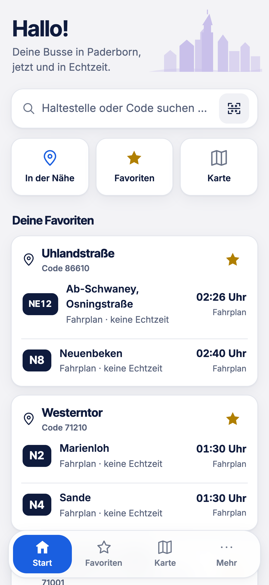
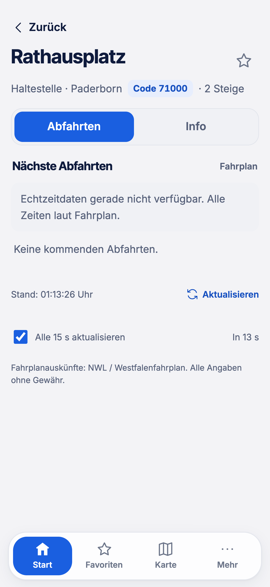
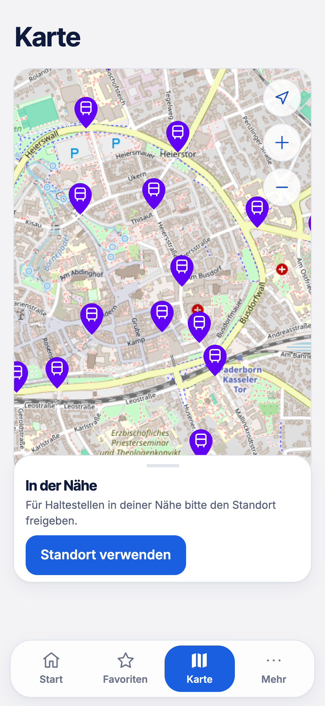
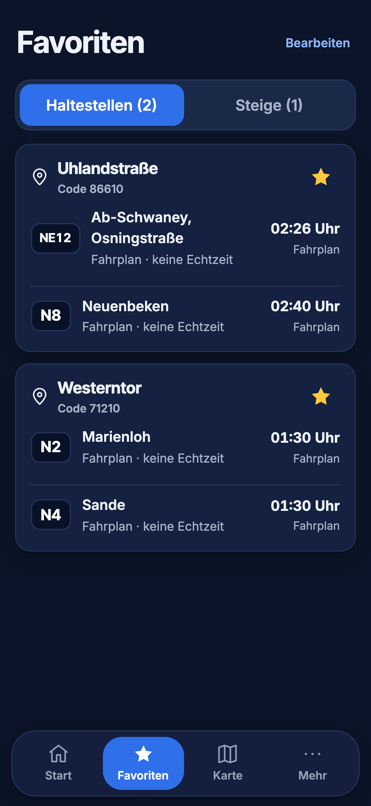

  

  # Abfino

  **Real-time public transport, simplified for Paderborn.**

  Mobile-first · Privacy-focused · Progressive Web App

## About the project

Abfino is an independently developed public transport application for Paderborn, Germany. It combines real-time departure information with a simple five-digit code system: instead of repeatedly entering an address or navigating through long stop identifiers, users can open a stop or platform directly with a short code.

The project is designed to make everyday bus travel faster and clearer while remaining lightweight, accessible, and privacy-conscious.

## Highlights

- Real-time departures with an honest timetable fallback
- A stable five-digit code for every supported stop and platform
- Stop, platform, direction, delay, and cancellation information
- Nearby stops using permission-based geolocation
- Favorites and quick access stored locally on the device
- Interactive OpenStreetMap view
- QR access for five-digit Abfino codes
- Installable Progressive Web App with offline states
- Responsive light and dark interfaces
- No user accounts and no behavioral tracking

## Interface

  
  
  
  

## Engineering notes

- Cloudflare Workers deployment
- NWL / Westfalenfahrplan as the primary departure source
- Schedule fallback without presenting planned data as live data
- Self-hosted typography and a dependency-light client
- Automated coverage for data handling, five-digit codes, PWA behavior, accessibility, and UI flows
- Tested responsive layouts for phones, tablets, and desktop screens

## Project status

Abfino is under active private development. The public demonstration link is intentionally withheld while data-provider approval and final real-device validation are in progress.

## Source availability

The source code is proprietary and maintained in a private repository. This public repository is a portfolio showcase and contains no application source code, credentials, production configuration, or private datasets.

## Independence and data attribution

Abfino is an independent project and is not an official product of the City of Paderborn, PaderSprinter, NWL, or Google. Timetable and departure information remains subject to the respective data providers and may change. Map data © [OpenStreetMap contributors](https://www.openstreetmap.org/copyright).

---

Designed and developed by **Yetsa**.
